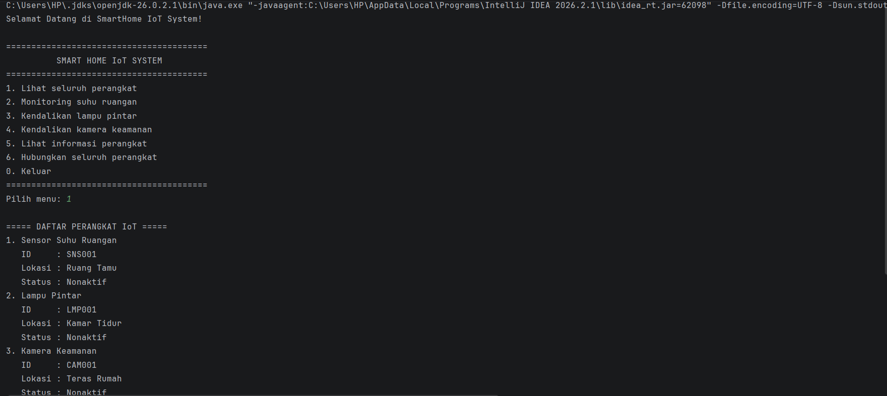
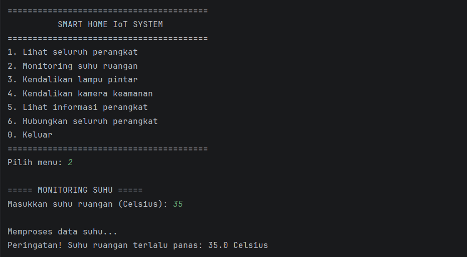
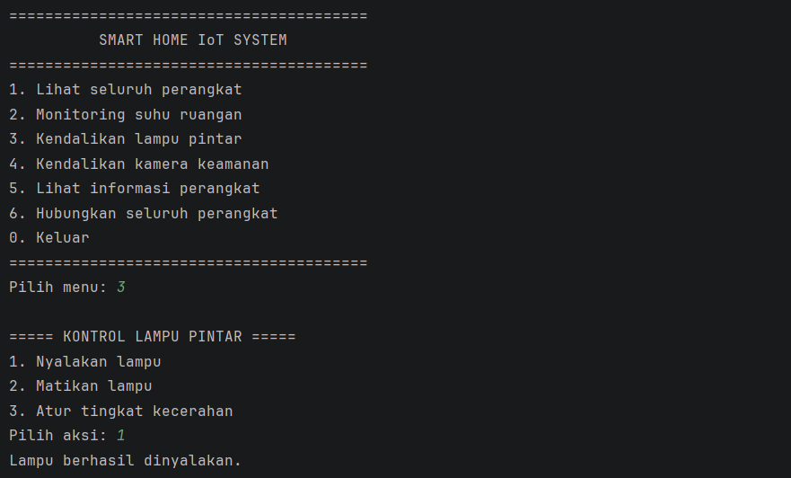
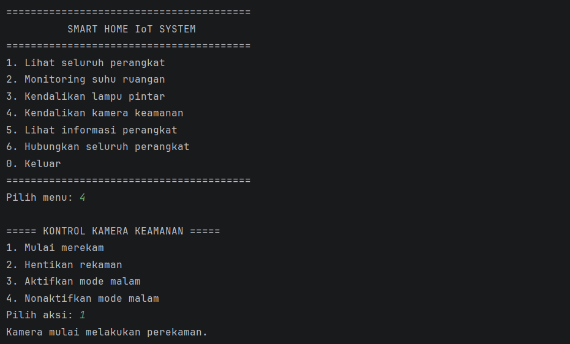

# SMART HOME IoT SYSTEM

## 1. Identitas Mahasiswa

| Keterangan | Identitas                      |
|---|--------------------------------|
| Nama | Zuvika Dwi Yustina             |
| NIM | H1D025124                      |
| Program Studi | Informatika                    |
| Universitas | Universitas Jenderal Soedirman |
| Tema NIM | IoT (Internet of Things)       |

## 2. Deskripsi Program

SmartHome IoT System merupakan program simulasi berbasis Java yang menggambarkan sistem rumah pintar (Smart Home) dengan tiga perangkat IoT, yaitu:

1. **Sensor Suhu** – Memantau suhu ruangan dan memberikan informasi kondisi suhu.
2. **Lampu Pintar** – Mengatur kondisi lampu serta tingkat kecerahan.
3. **Kamera Keamanan** – Mengendalikan perekaman dan mode malam kamera.

Program dijalankan melalui terminal atau command prompt menggunakan menu interaktif.

## 3. Petunjuk Compile dan Run

### A. Persyaratan

- Java Development Kit (JDK) telah terinstal.
- Git (opsional, untuk pengelolaan repositori).
- Terminal atau Command Prompt.

Periksa instalasi Java dengan perintah:

```bash
java -version
javac -version
```

### B. Struktur Folder

```text
Responsi-PBO-IoT/
├── src/
│   ├── Interface/
│   │   ├── DapatDikendalikan.java
│   │   └── Terhubung.java
│   ├── Model/
│   │   ├── KameraKeamanan.java
│   │   ├── LampuPintar.java
│   │   ├── PerangkatIoT.java
│   │   └── SensorSuhu.java
│   └── Main.java
└── README.md
```

### C. Compile Program

Buka terminal pada direktori utama proyek, kemudian jalankan:

```bash
javac -d out src/Interface/*.java src/Model/*.java src/Main.java
```

Perintah tersebut digunakan untuk mengompilasi seluruh file Java dan menyimpan hasil kompilasi ke folder `out`.

### D. Run Program

Setelah proses kompilasi berhasil, jalankan program menggunakan perintah:

```bash
java -cp out Main
```

Program akan menampilkan menu utama SmartHome IoT System pada terminal.

## 4. Screenshot Luaran Program

### A. Tampilan Menu Utama



### B. Monitoring Sensor Suhu



### C. Pengendalian Lampu Pintar



### D. Pengendalian Kamera Keamanan



---

**Catatan:** Program ini merupakan simulasi sistem SmartHome berbasis Java dan belum terhubung dengan perangkat keras IoT secara langsung.